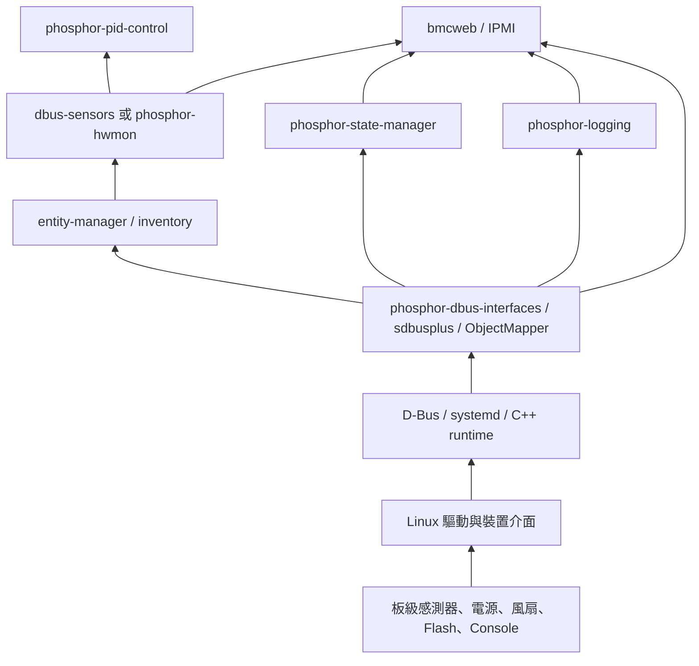

# OpenBMC → BMC-G1 相依性分析與移植規劃

本文保留早期套件相依性與架構選項研究。AeroBMC 現行範圍是精簡 OpenBMC 底層管理路徑的局部架構實驗，交付為 QEMU 最小可行核心（minimal viable core）。上游服務作為整合與相容性參考。 [專案定位](../README.md)

查閱日期：2026-11-03。範圍：主要管理服務的第一輪分析，不代表完整 SBOM、可建置配方或已通過硬體驗證。

## 1. 結論與決策界線

更新：依使用者要求，現在優先研究 B（ArceOS 管理功能）能否改善效能，A 保留作為原版套件重用及功能基準。具體比較方法見 [ArceOS 效能計畫](arceos-performance-plan.zh-TW.md)。此優先順序尚不代表已決定將管理功能放在 G1 主機同一故障域。

AeroTensor-G1 的核心是 Rust `#![no_std]` ArceOS 與 NPU 模組；OpenBMC 是 Linux BMC 韌體。CPU 都能是 ARM 並不代表兩者具備相同的程式執行環境。[A1][O1]

若目標是沿用 OpenBMC 原版套件，建議優先評估獨立的 Linux／OpenBMC 管理控制器，透過板級介面管理 G1。若目標是在 ArceOS 內提供管理功能，應視為功能與資料模型的移植，重寫平台後端及服務整合；不能將 C++ daemon 或 Yocto recipe 直接加入 `no_std` crate。

此建議是依已查閱相依性提出的工程判斷，尚未選定 BMC SoC，也未確認 G1 是否有獨立管理硬體。兩條路的工作量不可混在同一估算中。

`openbmc/docs` 是文件庫，套件原始碼分散於各元件 repository；映像整合另需 OpenBMC／Yocto 建置樹。[O1]

## 2. 已確認與尚未確認

已確認：

- G1 README 描述 `axcompute`、`axtensor_mem`、`axtensor` 及 QEMU 模擬環境。硬體規格與效能屬模型／目標，不能當作已存在的實體板卡能力。[A1]
- OpenBMC 以 D-Bus 表達感測器、服務探索及關聯；systemd 管理服務與主機電源狀態流程。[O2][O3][O4]
- 已逐一查閱七個主要元件的頂層 `meson.build`，相依性證據存於同目錄 JSON。

尚未確認：

- G1 實體板或模擬器是否提供溫度、電壓、功耗、PWM、tach、GPIO、I2C／PMBus、FRU EEPROM。
- reset、power enable、power good、watchdog、主機 console 的接線與擁有者。
- 獨立 BMC SoC、開機媒體、flash 分割、網路介面、管理電源域。
- ArceOS 目前可用的網路、TLS、持久儲存及管理排程能力；本輪未對其完整原始碼進行能力驗證。
- G1 與管理端的 mailbox／UART／MCTP 等傳輸協定、位址、IRQ、封包格式與存取權限。這些不能從 NPU SQ/CQ 直接推定。

## 3. 相依性分層

此圖是功能與執行環境的簡化關係，不是 BitBake 或連結器產生的完整相依圖。Entity Manager 並非所有感測器實作的必要條件；phosphor-hwmon 有獨立設定方式。bmcweb 也依功能選項呼叫更多 D-Bus 服務。[O2]

## 4. 主要套件矩陣

下表的建置依賴是已查閱頂層建置檔的重點摘錄，省略測試依賴與部分選項；實際組態需追查子目錄、wrap 與 Yocto recipes。ArceOS 欄為建議工作方式，非已完成成果。

| 元件 | 已確認的重要建置依賴／執行角色 | 獨立 Linux BMC | ArceOS 內移植 |
|---|---|---|---|
| phosphor-dbus-interfaces | 共用 YAML 介面定義，供服務與生成器使用；本輪未審閱其建置檔 | 保留上游介面 | 選取資料模型，另寫 Rust 型別；不等於提供 D-Bus 相容性 |
| sdbusplus / ObjectMapper | C++ D-Bus 整合與物件探索；Mapper 文件已讀，兩者建置檔待審閱 | 保留服務與函式庫 | 以靜態 registry／事件介面替代需改寫呼叫者；完整 D-Bus 相容成本高 |
| entity-manager | Boost、JSON、PDI、sdbusplus、logging、zlib、libxml2、systemd；FRU 模式用 libi2c，GPIO 選項用 libgpiodcxx | 建板級 inventory、probe 與配置 | 先做固定 inventory，後續才加入動態偵測 |
| dbus-sensors | Boost、JSON、sdbusplus、logging、liburing、libi2c、libgpiodcxx；不同 daemon 另有依賴 | 接 Linux 驅動與 Entity Manager 設定 | 重寫讀值、排程、門檻、可用性與事件；不可假設 Linux io_uring 可用 |
| phosphor-hwmon | 官方文件確認 Linux hwmon → D-Bus；建置檔待審閱 | 可作較單純的感測器起點，與 dbus-sensors 依需求選擇 | 沿用感測語意，替換 sysfs／D-Bus 後端 |
| phosphor-state-manager | sdbusplus、sdeventplus、PDI、logging、systemd；部分功能用 libgpiod | 補電源流程、GPIO 與狀態設定 | 重寫狀態機、計時器、重試及硬體控制；不得照搬 systemd targets |
| phosphor-logging | libsystemd、sdbusplus、PDI、sdeventplus、cereal、JSON、CLI11；Python 與 sdbus++ 生成工具 | 設持久化、保留量與事件對應 | 重寫事件緩衝、儲存與查詢，定義容量及掉電行為 |
| phosphor-pid-control | libsystemd、sdbusplus、PDI、logging、JSON、CLI11；libipmid 依 ipmi 選項 | 配 zone、風扇與保護策略 | 可評估控制演算法重用，重寫 timer／I/O／配置；需驗證失效保護 |
| bmcweb | PAM、OpenSSL、Boost、sdbusplus、libsystemd、JSON、nghttp2、tinyxml2、zlib、CLI11；zstd 可選 | 感測器與狀態服務就緒後接 Redfish | 另建 HTTP/TLS、認證、授權與資料適配；保留少量 URI 不代表完整 Redfish 相容 |
| phosphor-host-ipmid | 已查閱頂層建置檔；依賴摘要見 JSON，命令 provider、transport 與子目錄仍需追查 | 最小 Redfish 驗證後按需求加入；LAN transport 另查 net-ipmid | 先定所需命令與 transport，不能只移命令 handler 就宣稱支援 IPMI |
| 韌體更新服務 | 本輪查找 phosphor-software-manager/meson.build 回傳 404；實際更新元件、配方、簽章與儲存後端待確認 | 確認上游元件與板級 flash 機制再規劃 | 另設映像格式、信任根、驗章、原子切換與復原；不先寫 flash |

建置檔來源見 JSON 的 `source_url`；條件式依賴必須配合各專案 options 解讀。404 僅表示此次請求無法取得該路徑，不能據此斷定功能不存在。

## 5. 兩種目標架構

### A：獨立 OpenBMC 管理 G1（原版套件重用方向）

管理端執行 Linux、D-Bus、systemd 與上游 daemon，G1 保留 ArceOS。先以已受支援的 BMC／QEMU 平台驗證上游服務，再加入 G1 管理介面。QEMU 僅驗證軟體鏈路，不代表 G1 電源或散熱硬體已驗證。

需交付 BMC 板級支援：machine／layer、kernel device tree、driver、inventory、sensor／fan 配置、power sequencing、flash layout。不能用 G1 的 ARM 型號代替 BMC SoC 型號；若沒有獨立控制器，也不能聲稱具備主機斷電後仍可用的帶外管理。

### B：ArceOS 內建管理功能（功能移植方向）

可提出 `axbmc-core`、`axbmc-platform`、`axbmc-api` 等新模組，名稱僅供規劃。核心先提供型別化 inventory、sensor、event、power state model，平台層承接實際裝置；API 層最後加入網路與存取控制。

管理工作必須有明確 CPU、記憶體、鎖與排程預算，並量測是否影響推論延遲。與主機同一電源及故障域的管理模組，無法在主機失去執行能力時繼續管理；如有該需求，應選 A 或另設獨立管理核心。

## 6. 建議移植順序與驗收

| 階段 | 工作與交付 | 驗收條件 |
|---|---|---|
| P0 目標固定 | 選 A／B、列明板卡或模擬目標、固定上游 commit 與套件選項、完成介面表 | 每個裝置列出來源、單位、可用性、讀寫權限；每個控制列出回饋與逾時；無資料者標記未支援 |
| P1 基礎環境 | A：可開機 Linux BMC、D-Bus／systemd／Mapper；B：可編譯 no_std 核心與 mock HAL | 可重現建置與啟動；mock 與實體後端可辨識；不以虛構值冒充實體 telemetry |
| P2 Inventory／Sensor／Event | 固定 inventory、溫度與功耗等實際可用來源、門檻與事件 | 驗證單位轉換、上下界、讀取失敗、過期值、門檻往返；事件可關聯設備且不重複洗版 |
| P3 控制 | 風扇控制、watchdog、電源狀態機；先模擬再接實體 | 驗證 sensor 遺失／風扇故障、計時器逾時、重複命令、power-good 未到與重試上限；保護值由板級規格決定 |
| P4 外部 API | A 接 bmcweb；B 先做已宣告範圍的管理 API | 未授權請求被拒、可用性與單位正確、狀態與後端一致；Redfish 支援範圍與 schema 驗證結果列明 |
| P5 進階功能 | 按需求加入 IPMI、console、更新、帳號持久化 | IPMI 有 transport 及權限測試；更新有驗章失敗、斷電、回滾及復原驗證；儲存容量與生命週期已評估 |

每階段都保留可重現命令、預期結果與失敗紀錄。此輪僅產生規劃文件，沒有執行上述建置或驗收，亦未執行 G1 standalone testbench。

## 7. 開始實作前需要的輸入

1. 選擇 A（Linux BMC）或 B（ArceOS 管理功能），及第一個要跑通的 QEMU／板卡目標。
2. 最小功能集合：只讀 telemetry、遠端電源、風扇、Redfish、IPMI 各自是否必要。
3. 硬體介面表：sensor 型號／匯流排／位址、GPIO 極性、電源時序、PWM／tach、watchdog、flash layout 與 console。
4. 若採 A，提供 BMC SoC 與 BSP；若採 B，指定 ArceOS 平台、網路與儲存方案。

在這些輸入確定前，適合先做模擬資料模型及介面驗證；不適合編造 DTS 位址、實體控制暫存器或散熱門檻。工期需於 P0 完成後分架構估算。

## 8. 證據與後續調查

- [A1 AeroTensor-G1 README](https://github.com/tony126051/aerotensorg1/blob/main/README.md)
- [O1 OpenBMC 文件入口](https://github.com/openbmc/docs/blob/master/README.md)
- [O2 感測器架構](https://github.com/openbmc/docs/blob/master/architecture/sensor-architecture.md)
- [O3 ObjectMapper](https://github.com/openbmc/docs/blob/master/architecture/object-mapper.md)
- [O4 systemd 與電源流程](https://github.com/openbmc/docs/blob/master/architecture/openbmc-systemd.md)

本輪使用預設分支讀取；JSON 記錄已取得檔案的 Git blob SHA，可用於比對內容，但不是跨套件一致的 release／commit lock。正式建置需固定每個 repository commit、Yocto release／layers、recipe SRCREV 與 options，再解析完整遞迴相依性、license 和 SBOM。

待補查元件包括 sdbusplus、sdeventplus、PDI、Mapper 的建置與生成依賴；hwmon、net-ipmid、console、user manager、更新服務及其 Yocto recipes。套件矩陣以核心功能為限，不代表全部 OpenBMC 套件已盤點。
